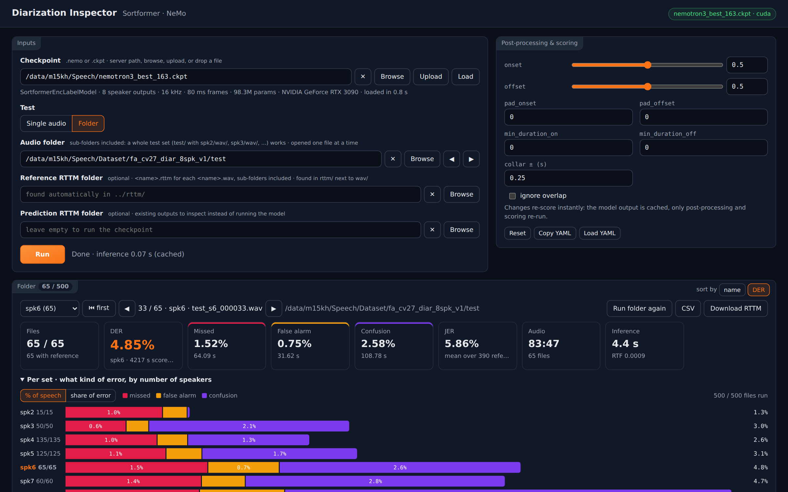
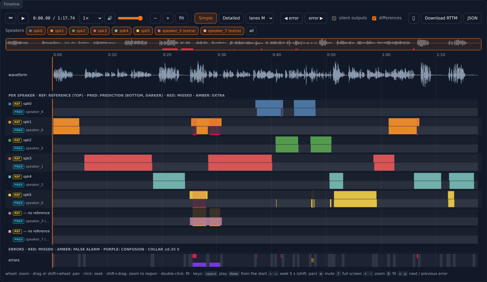
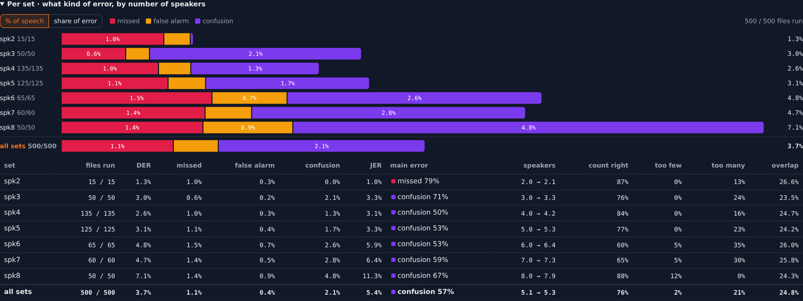
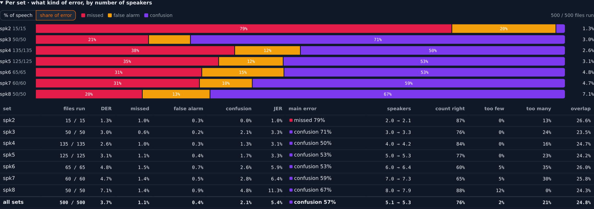
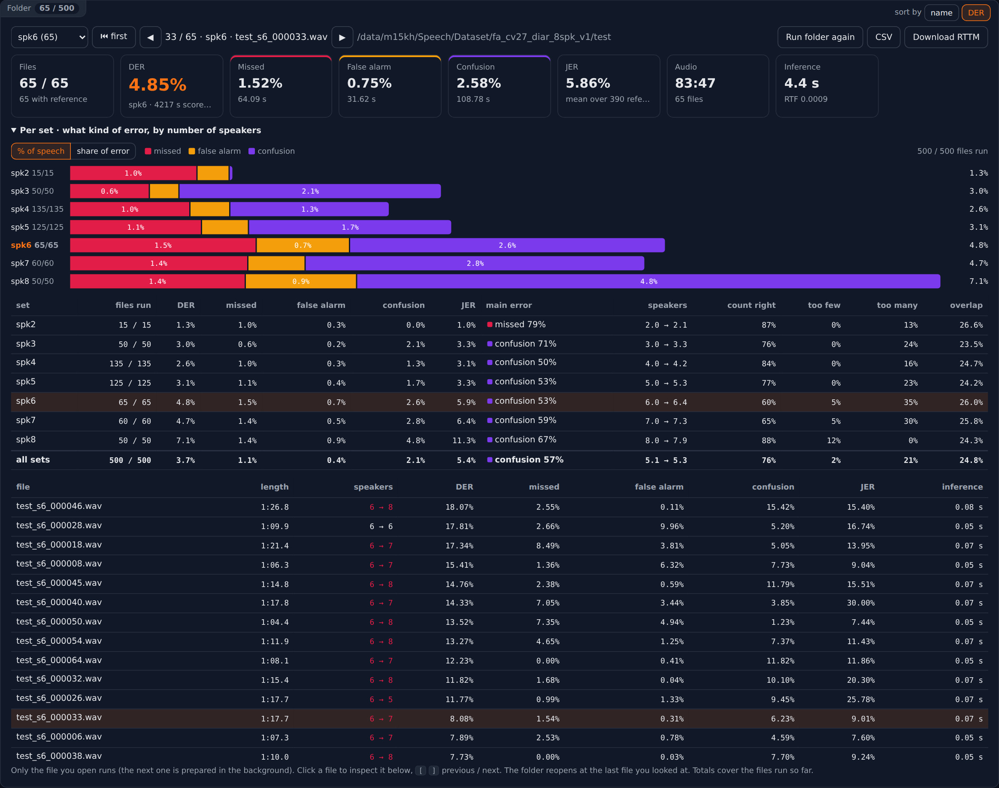
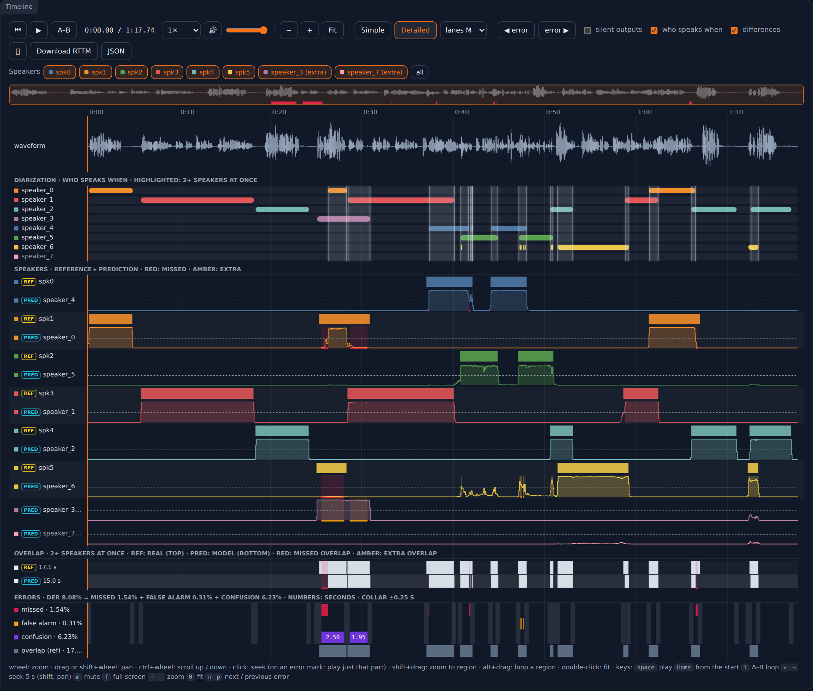
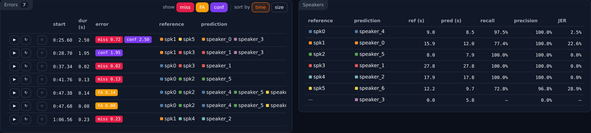

# Diarization Inspector

A small web UI to run a NeMo Sortformer diarization checkpoint on an audio file, or a whole test set, and see exactly where it is wrong,
and to correct the reference labels by hand where they are wrong themselves ([Label](#label)).
FastAPI backend (Python) + plain HTML/JS frontend. No database, no build step.



Every reference speaker next to the predicted speaker it was matched to, with what the model missed (red), added (amber) and confused (purple):



*Screenshots: a 98M-parameter, 8-output Sortformer checkpoint on a Persian test set of 500 files with 2 to 8 speakers (`test/spk2` ... `test/spk8`).*

## Run

Use the Python environment where NeMo is installed (the one you train with):

```bash
pip install -r requirements.txt
python3 backend/server.py                http://127.0.0.1:7860
```

| option | |
|---|---|
| `--checkpoint PATH` | load a `.nemo` / `.ckpt` at startup |
| `--audio PATH` | audio file to open (`.wav`, `.flac`, ...), or a folder to step through (a `wav/` + `rttm/` dataset folder too) |
| `--rttm PATH` | reference RTTM file or folder (also `--ref-rttm`). Default: found next to the audio or in `../rttm/` |
| `--hyp-rttm PATH` | prediction RTTM file or folder to inspect instead of running the checkpoint |
| `--device auto` | `auto`, `cpu`, `cuda`, `cuda:1`, ... |
| `--port 7860` | |
| `--host 127.0.0.1` | `0.0.0.0` makes it reachable from other machines; the UI can browse the server's files, so only do that on a trusted network |

Server on a remote GPU machine: run it there and tunnel the port, then open http://localhost:7860 locally:

```bash
ssh -L 7860:localhost:7860 user@gpu-server
```

### Set the inputs from the terminal

Everything can also be chosen in the UI. The paths given on the command line are filled into the UI fields when the page opens:

```bash
# checkpoint + audio: the model loads at startup and the file runs as soon as the page opens
python3 backend/server.py --checkpoint /models/sortformer_8spk.nemo --audio /data/test/wav/meeting_01.wav

# with an explicit reference RTTM
python3 backend/server.py --checkpoint /models/sortformer_8spk.nemo \
    --audio /data/test/wav/meeting_01.wav --rttm /data/test/rttm/meeting_01.rttm

# no model: inspect an existing prediction (pyannote, DiariZen, an older run, ...)
python3 backend/server.py --audio /data/test/wav/meeting_01.wav --hyp-rttm /runs/pyannote/meeting_01.rttm

# a whole folder: step through the wavs, each scored against the RTTM with the same name in the RTTM folder
python3 backend/server.py --checkpoint /models/sortformer_8spk.nemo --audio /data/test/wav --rttm /data/test/rttm

# a whole test set: every */wav/*.wav under test/, each scored against the RTTM in the rttm/ next to its wav/
python3 backend/server.py --checkpoint /models/sortformer_8spk.nemo --audio /data/test

# a folder of existing predictions against the references
python3 backend/server.py --audio /data/test/wav --rttm /data/test/rttm --hyp-rttm /runs/pyannote

# only the checkpoint: the audio fields keep what you used last time
python3 backend/server.py --checkpoint /models/sortformer_8spk.nemo
```

- Paths can be relative to the folder you start the server in, or start with `~`. A path that does not exist stops the server with an error.
- Without `--rttm`, the reference is looked up the same way as in the UI: `meeting_01.rttm` next to the audio, in `../rttm/` or in `./rttm/`. The terminal shows which one was found.
- With `--audio`, the RTTM fields only hold what was given or found for that file. RTTMs left over from another file are cleared.
- The page opens with these paths once per server start. If you change a field in the UI and reload the page, your change stays. Restart the server to apply the terminal paths again.

## Use

1. **Checkpoint**: a path on the server (Browse lists `.nemo` / `.ckpt`). The model stays loaded. The number of speaker outputs (2, 4, 8, ...) is read from the checkpoint.
2. **Single audio / Folder**: test one audio file, or a folder of them (see [Folders](#folders)).
   Each mode keeps its own paths, so switching back and forth loses nothing.
3. **Audio**: a server path, Browse, Upload, or drag and drop. ◀ ▶ step to the previous / next file of its folder and run it.
   In **Folder** mode this is the folder (Browse → **Use this folder**, or click any file in it); uploads switch to Single audio.
4. **Reference RTTM** (optional): ground truth. It is found automatically next to the audio or in `../rttm/` (the `wav/` + `rttm/` layout of the datasets).
5. **Prediction RTTM** (optional): inspect any existing output (pyannote, DiariZen, older runs, ...) instead of running the model.

### Folders

Choose **Folder**, put a folder in **Audio folder** (and optionally in **Reference RTTM** / **Prediction RTTM**) and press Run, or give the folders in the terminal:

- Sub-folders are searched too, so a whole test set works from its top folder: `test/` finds `spk2/wav/*.wav`, `spk3/wav/*.wav`, ... and each one's reference in the `rttm/` next to its `wav/`.
  The **set** column (and the CSV's `group`) says which sub-folder a file came from (`spk2`, without the `wav/`).
  The set selector above the table (**all sets** / `spk2 (15)` / `spk3 (50)` / ...) narrows everything to one set: the table,
  ◀ ▶ and `[` `]`, ⏮ first, **Run all** and the totals, so the totals show the DER of that set. It is remembered per folder.
- **Per set** (when the folder has 2+ sets): which kind of error each set has, e.g. whether 8-speaker files fail by confusion
  rather than by false alarms.

  

  In the screenshot, 2-speaker files lose most to missed speech, while from 3 speakers on confusion dominates and grows with
  the number of speakers (4.8% of the speech at 8 speakers). **share of error** makes the mix easier to compare:

  

  - A bar per set split into missed / false alarm / confusion, and one for **all sets** (the whole folder) below them. **% of speech**: the parts add up to the set's DER.
    **share of error**: each part as a share of that set's error, so the dominant one stands out. Hover a part for its numbers.
  - A table per set (and all sets): DER, missed, false alarm, confusion, JER, the **main error**, mean speakers reference →
    predicted (green: right, red ▼: too few, amber ▲: too many; the same colors in the file table and the Speakers card), how often the speaker count is right / too few / too many, and the share of overlapped reference speech.
  - Click a set (bar or row) to show only that set; click it again for all sets. Numbers cover the files run so far:
    **Run all sets** runs the rest of every set.
  An RTTM folder is searched the same way, by file name.
- Only the file you open runs, so a large folder opens at once. ◀ ▶ (next to Audio or above the table) or `[` `]` step to the previous / next file. The next file is prepared in the background, so stepping forward is usually instant (it may delay a file you jump to elsewhere by one inference).
- The folder reopens at the file you looked at last (remembered per folder in the browser). **⏮ first** starts over. After a page reload the folder reopens on its own if its checkpoint is already loaded.
- Each audio file is paired with the RTTM of the same name: `wav/meeting_01.wav` ↔ `rttm/meeting_01.rttm`.
  An RTTM *file* in a folder field means its folder. With the reference field empty, it is looked up next to each audio file, in `../rttm/` or in `./rttm/`.
- **Run all** runs the files not run yet, one after the other, for the totals over the whole folder. The **Folder** table fills in as files finish (opened, prepared or run): length, speakers (reference → predicted), DER, missed, false alarm, confusion and JER per file. Files without a reference show `–`.
- **Totals** at the top: DER over all files run so far, computed from the summed error and speech time of every file (the way NeMo and pyannote report a total). It is not the average of the per-file DERs. Total JER is the mean over the reference speakers of all files, like dscore.
- **Sort by DER** puts the worst files first. **Click a file** to open it in the full inspector below (timeline, errors, speakers).
- Changing post-processing, the collar or "ignore overlap" re-scores the whole folder. Model outputs are cached, so the totals update in seconds.
- **Run folder again** reruns every file, for example after loading another checkpoint. **Stop** stops after the current file.
- **CSV**: one row per file. **Download RTTM**: all predictions in one RTTM file.



The post-processing fields use NeMo's `PostProcessingParams` names. Changing them, the collar or "ignore overlap" re-scores instantly: the model output is cached, so only post-processing and scoring re-run. **Copy YAML** gives a `postprocessing_yaml` for `e2e_diarize_speech.py`. **Load YAML** (or dropping a `.yaml` file on the page) does the reverse: it reads the values from such a file (keys under `parameters:` or at the top level; `collar` and `ignore_overlap` too), and settings it does not name keep their value.

What you get:

- **Metrics**: DER = missed + false alarm + confusion, JER, speaker count, overlap, inference time / RTF.
- **Timeline**, in two views (all rows share one zoomable time axis):
  - **Simple** (default): the waveform, then one compact lane per speaker with the reference on top (yellow **REF** badge) and its matched prediction right below (cyan **PRED** badge, darker background) in the same color (with **differences** on: red where the prediction misses the reference, amber where it adds speech the reference does not have), then one error lane (missed / false alarm / confusion);
  - **Detailed**, with every speaker on its own lanes:
    - the waveform;
    - **diarization**: who speaks when, one lane per predicted speaker, with highlighted columns where 2+ speakers talk at once
      in compact lanes (they keep their height when **lanes S / M / L / XL** changes; the **who speaks when** checkbox hides them);
    - each reference speaker, with the predicted speaker it was mapped to drawn below in the same color; with **differences** on, that lane is marked red where the reference speaker talks but the prediction misses it and amber where the prediction adds speech the reference does not have (collar excluded);
    - the model's speaker probability, with the onset/offset thresholds as dashed lines;
    - error lanes: missed / false alarm / confusion / reference overlap (gray = inside the collar, not scored);
  - both: the error lanes say what each error type adds to the DER (`missed · 0.6%`, in % of scored speech, so the three
    add up to the DER), and every mark wide enough shows its length in seconds (`1.05 s`). The section header shows the
    sum: `DER 16.63% = (missed 0.00 s + false alarm 1.05 s + confusion 1.44 s) ÷ 15.0 s scored speech`. Scored speech is
    the reference speech minus the collar around every boundary, so on a short file with many turns and a wide collar a
    few seconds of error can be a large DER;
  - both: an **Overlap** lane, where 2+ speakers talk at once: the real overlap (REF, from the reference) on top and the
    model's (PRED) below, each with its total seconds; with **differences** on, red where the model misses real overlap and
    amber where it predicts overlap that is not there. Click a part to play it;
  - both: **lanes S / M / L / XL** sets the height of the speaker and error lanes, an overview strip with every error position, and **Speakers** chips above the timeline: click to hide / show a speaker, double-click to show only that one, **all** to show everyone.

  
- **Error list**: click a row to zoom to it, ▶ to listen to it. Show only some error types (**miss** / **FA** / **conf**; ◀ error ▶ follows the same choice). Sort by time or by size.
- **Speakers table**: mapping, talk time, recall and precision per speaker.

  
- **Saved errors**: ☆ on an error row saves it (★ = saved, click again to remove). The server writes the audio around it
  (1 s before and after) as `saved/<file>_<start>s_<type>_<id>.wav` and everything about it as a JSON next to it: audio path,
  set, time, error type and seconds, speakers, the reference / prediction segments around it, checkpoint, post-processing
  settings and the file's DER. `saved/saved.csv` lists all of them. The **Saved errors** panel (★ N saved in the header jumps
  to it) searches them by file, set, type, speaker or note, plays the clip, keeps a note per error, **Open** goes back to
  the file at that error, **WAV** downloads one clip and **Download all** gives a zip with every clip, JSON and the CSV.
- **Download**: RTTM, or JSON (includes the raw speaker probabilities).

**A–B loop**: press **A–B** (or `l`) to set A at the playback position, move on and press it again to set B: playback then
repeats A → B until you press it a third time. **Alt+drag** on the timeline loops the dragged region, and ↻ on an error row
loops that error (0.3 s on each side). The loop shows as a shaded band with A / B markers; opening another file clears it.

Mouse: click on an error mark (missed / false alarm / confusion lane) = play just that part, wheel = zoom, drag or shift+wheel = pan, ctrl+wheel = scroll the page up / down (to reach the lanes below when there are many speakers), click = seek, shift+drag = zoom to a region, double-click = fit.
Keys: `[` `]` previous / next file, `space` play, `Home` play from the start, `l` A–B loop, `←` `→` seek 5 s (`shift` + `←` `→` pan), `m` mute, `f` full screen (metrics, timeline, error list and speakers table; `Esc` leaves), `+` `−` zoom, `0` fit, `n` / `p` next / previous error.

## Label

The **Label** tab (next to **Inspect** at the top) corrects RTTM labels by hand: open an audio file with its RTTM, fix the
segments that are wrong and save.

1. **Audio**: a server path, Browse, Upload, or drop a file. ◀ ▶ (or `[` `]`) step through its folder.
2. **Labels RTTM** (optional): found automatically next to the audio or in `../rttm/`, like the reference in the Inspect tab.
   Empty: label from scratch. **Start from model prediction** starts from what the Inspect tab's checkpoint predicts (with its
   post-processing settings) instead.
3. **Save** (`ctrl+s`) writes the RTTM under **Save as**. With a **Save to folder**, e.g. `rttm_corrected`, that is
   `rttm_corrected/<name>.rttm` (named like the original RTTM), and the original RTTMs stay as they are. A folder given by
   name goes beside `wav/` and `rttm/` (or into the audio's folder when that is not a `wav/` folder); a full path works too.
   A file opens with the labels saved in that folder before, when there are some, else with its original RTTM, so a test
   set can be corrected file by file with ◀ ▶. Without a folder, Save replaces the RTTM opened (or writes `<name>.rttm`
   where it is looked up: `rttm/` next to a `wav/` folder, else next to the audio). The first time an RTTM is replaced, a
   copy of the original goes to `data/label_backups/`. Lines of other recordings in the same RTTM are kept. **Download
   RTTM** gives the labels as they are, saved or not.
4. **Unsaved changes are never lost**: after every change they are kept in the browser (● unsaved changes · draft kept).
   If the page is closed or crashes, opening the file again brings them back; ↶ Undo then returns to the RTTM on disk.
   Saving, or discarding them when asked, forgets them.

One lane per speaker under the waveform:

- **drag a segment** to move it. Up or down onto another lane gives it to that speaker (its times stay unless you also drag
  sideways); onto **+ new speaker** to a new one;
- **drag its edges** to change where it starts or ends. Edges snap to the other segments' edges and to the playback cursor
  (hold `ctrl`, or untick **snap**, to place them freely);
- **drag on an empty part of a lane** to add a segment;
- **click a segment** to select it: the playback cursor goes to its start, and `space` / ▶ then play just that segment
  (click the selected segment again to put the cursor where you click, e.g. to split it there). Selecting a segment during
  playback plays it. The bar above the lanes shows its speaker, start and end (type exact times there) and play / split /
  join / delete;
- a segment that ends up overlapping another segment of its speaker merges with it;
- **Speakers** table: rename (spaces become `_`, since RTTM fields are separated by spaces), **merge into** another speaker
  (one person labeled as two), delete.

Keys: `space` play / pause (with a segment selected: just that segment), `Enter` play the selected segment from its start,
`1`–`9` give it to that speaker, `s` split it at the playback cursor,
`j` join it with the next segment of its speaker, `i` / `o` set its start / end to the playback cursor, `Delete` delete it,
`n` / `p` next / previous segment, `ctrl+z` / `ctrl+shift+z` undo / redo, `ctrl+s` save, `Esc` deselect (or cancel a drag),
and `←` `→` `+` `−` `0` `[` `]` as in the Inspect tab. Unsaved changes show as ● on the tab; leaving the page or opening
another file asks first (and a draft is kept all the same, see above).

**✎ Edit labels** in the Inspect tab's timeline opens the file shown, with its reference RTTM, in the Label tab at the same
place: an error of the model that turns out to be a labeling mistake is fixed right there. **Inspect with these labels** goes
the other way: the file in the Inspect tab, scored against the saved labels.

## Scoring

- 10 ms frames, optimal one-to-one speaker mapping (Hungarian), DER = (missed + false alarm + confusion) / reference speech.
- JER (DIHARD / dscore): per reference speaker 1 − IoU with its optimally mapped prediction (separate IoU-maximizing mapping, 100% when unmatched), averaged over reference speakers. Same collar / overlap settings as DER. pyannote.metrics maps speakers by overlap time instead, so its JER can be a little higher.
- **Collar** is ± seconds around every reference boundary (NIST / NeMo convention). pyannote's `collar` is the *total* width,
  so pyannote `collar=0.25` equals collar ±0.125 here.
- If the reference has a speaker overlapping with themselves, that time is counted once. pyannote.metrics counts it twice.
- Checked against pyannote.metrics on 720 RTTM pairs: within 0.2 DER points.
- Predicted segments come from NeMo's own post-processing, identical to `SortformerEncLabelModel.diarize()`.

## Files

```
backend/server.py    FastAPI app: the API, and serves the frontend
backend/model.py     NeMo wrapper: load .nemo / .ckpt, inference, post-processing
backend/scoring.py   RTTM read/write, DER, speaker mapping, error regions
frontend/            index.html, app.js (UI), timeline.js (canvas timeline), labeler.js (the Label tab's editor), style.css
docs/images/         the screenshots in this README
```

## Notes

- Inference is offline (whole file in one pass). That is fine for minutes of audio; hours may run out of GPU memory.
- The last 256 model outputs are cached in memory (only the speaker probabilities: about 70 KB per 3 minutes of audio with 8 speakers). Nothing is written to disk except saved errors (`saved/`), the RTTMs the Label tab saves (with a copy of each original it replaces in `data/label_backups/`), uploads and decoded audio, which go to `data/` in the project. The Label tab's unsaved changes are kept in the browser (local storage, the last 20 files). Uploads are in `data/uploads/`: `audio/`, `rttm/` (reference), `pred_rttm/` (prediction), `checkpoints/` and `folders/` (uploaded folders). Audio the model cannot read directly (m4a, webm, ...) is converted to WAV once and kept in `data/decoded/`. Re-uploading a file with the same name replaces it.
